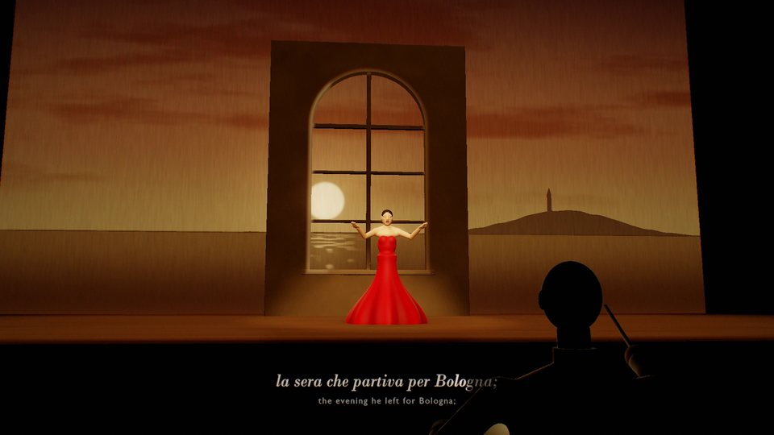
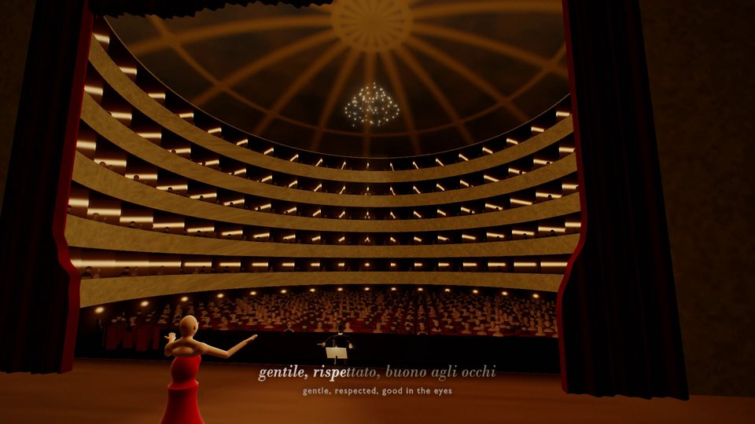
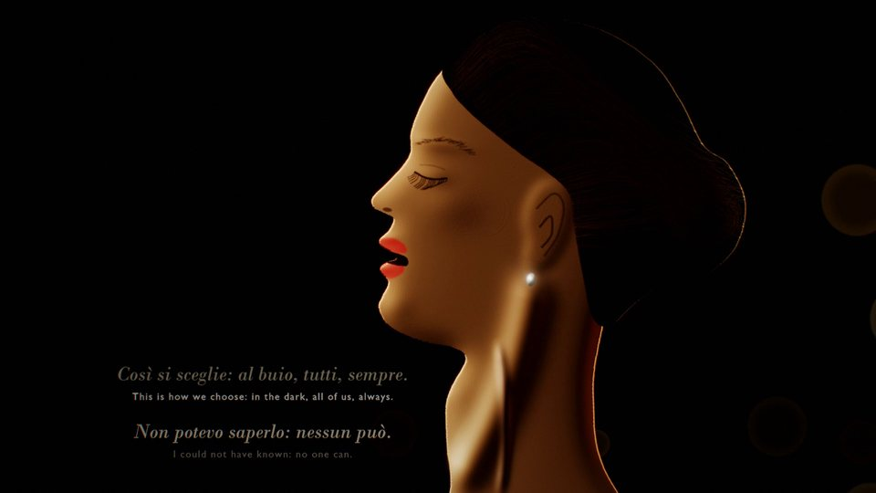
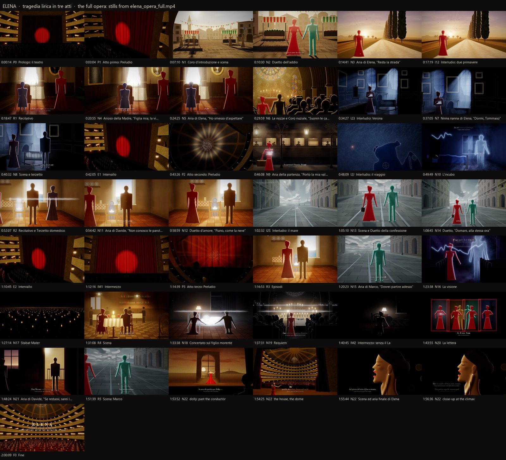

# ElenaVid

### An opera made entirely in code: libretto, score, five-tier sound design and motion graphics

<p align="center">
  
  
  
</p>

## Executive summary

ElenaVid is a Python and GLSL pipeline that turns a written treatment into an opera, and the opera into film. It ships with *Elena*, a *tragedia lirica* in three acts, in two editions:

- **The film:** a ten-minute motion-graphics telling.
- **The full opera:** the whole work, about two hours, staged in a painted theatre.

Nothing is sampled, filmed or produced by a generative model:

- every note is composed as data;
- every sound is synthesised by models written for the project;
- every frame is drawn by shaders on the GPU.

The pipeline runs in four stages, and each reads only what the one before it wrote:

1. A libretto in Italian, with an English translation.
2. A score, composed as data.
3. A performance, synthesised and mixed in five sound tiers: voices, orchestra, foley, environments and design.
4. The picture: scenes, surtitles revealed syllable by syllable as they are sung, leitmotifs drawn as light, and a ray-marched opera house.

It runs on Windows, macOS and Linux with Python, ffmpeg and an OpenGL 4.3 GPU. An NVIDIA GPU is used for encoding when present; otherwise ElenaVid encodes with x264 in software.

## Quick start

```bash
git clone https://github.com/OWNER/ElenaVid.git
```
```bash
cd ElenaVid
```
```bash
python -m venv .venv
```

Activate the environment (`.venv\Scripts\activate` on Windows, `source .venv/bin/activate` elsewhere), then:

```bash
pip install -e .
```
```bash
elenavid qa environment
```
```bash
elenavid build
```

`elenavid build` composes the film's score, renders and masters its sound, renders its picture, and writes `output/elena_opera.mp4`. Add `--edition full` to build the two-hour opera into `output/full/`.

## What it makes

| Edition | Length | Outputs |
|---|---|---|
| `film` (default) | 10:00 | `output/elena_opera.mp4`, a 24-bit stereo master, five tier stems, the score as MIDI, the timeline |
| `full` | 2:00:24 | `output/full/elena_opera_full.mp4`, a 24-bit master, five FLAC stems, a per-section level report, MIDI, the timeline |

<p align="center"></p>

The full opera, one still per section. The film's sheet is in [`docs/images/film_contact_sheet.jpg`](docs/images/film_contact_sheet.jpg).

## Requirements

- **Python 3.12 or later.** Version 1.0.0 was made and tested with Python 3.13; [`requirements.txt`](requirements.txt) pins the exact package versions.
- **ffmpeg** on the path, built with libx264 (most builds are).
- **A GPU with OpenGL 4.3.**
- **Optionally, an NVIDIA GPU.** It is used for H.264 encoding (NVENC) when it is detected.
- **Disk:**
  - the film needs about 2 GB of working space;
  - the full opera needs about 30 GB, most of it a render cache you can delete afterwards.
- **Time,** for the full opera on the reference machine (Ryzen AI 9 365, 10 cores, with an RTX 5080 laptop GPU):
  - the score takes about a minute;
  - the sound about 20 minutes;
  - the picture about 30 minutes with NVENC, longer with x264.

  The film takes a fraction of that.

## Commands

| Command | What it does |
|---|---|
| `elenavid score` | compose the score; write the MIDI file and the timeline that sound and picture read |
| `elenavid audio` | render the five tiers, mix and master (`--workers=N` for the full opera's parallel render) |
| `elenavid video` | render the picture and lay in the master audio (`--png=t1,t2,...` writes stills instead) |
| `elenavid build` | score, then audio, then video |
| `elenavid encoder` | say which H.264 encoder this machine would use, and why |
| `elenavid qa TOOL` | run a quality check (below) |

Every command takes `--edition film` (the default) or `--edition full`. `python -m elenavid` works the same as `elenavid`.

### The encoder

ffmpeg lists NVIDIA's `h264_nvenc` encoder whether or not an NVIDIA GPU is present. ElenaVid therefore tests it by encoding a fraction of a second, and only uses it if that succeeds. Otherwise it encodes with `libx264` in software, or with `libopenh264` if a build lacks x264.

- To force a choice, use `--encoder=nvenc|x264` or the variable `ELENA_ENCODER`.
- To adjust quality, use `--cq=` (NVENC), `--crf=` (x264), `--rate=`, `--maxrate=` and `--preset=`.

The full opera is rendered in five-minute chunks, two processes at a time by default (`--jobs=`). The chunks are resumable, and they are joined without re-encoding.

### Environment variables

| Variable | Meaning |
|---|---|
| `ELENA_EDITION` | `film` or `full` (the same as `--edition`) |
| `ELENA_ROOT` | the project folder holding `opera/` and `output/` (default: the repository) |
| `ELENA_CACHE` | where the full opera's render caches go (default: the user cache folder) |
| `ELENA_ENCODER` | `auto`, `nvenc` or `x264` |
| `ELENA_FONTS` | a folder searched first for the typefaces |
| `SHIM_MCCOMPAT` | Windows laptops with two GPUs only: `0x800000001` for the render process asks the NVIDIA driver to run OpenGL (it is not a system setting) |

## Quality checks

`elenavid qa TOOL [--edition film|full]`; the tools with pass/fail checks exit with status 1 on failure, so they can gate a release.

| Tool | Checks |
|---|---|
| `environment` | packages, ffmpeg, the encoder this machine would use, the OpenGL renderer, fonts, free disk space |
| `timeline` | every instrument has a renderer, every note sits inside its section; sections, locations, singing time, leitmotifs, cues (`--cues`) |
| `events` | calls every sound generator in the cue sheet with its real arguments, in seconds rather than an hour into a render |
| `prosody` | the share of stressed syllables on strong beats, and the melodic intervals (full opera) |
| `levels` | BS.1770 loudness per section of the master or any file (`--file=`); `--plot` draws the curve (needs matplotlib) |
| `delivery` | the delivered MP4's streams, loudness (-16 LUFS) and true peak (-1 dBTP), sample-accurate sync with the master, the picture and sound at the story's anchor cues, and the joins between render chunks |
| `contact-sheet` | stills from the delivered file, one per section, plus the required shot's moments |
| `qc-sheet` | sheets of the stills written by `elenavid video --png=...` |
| `compare-frames` | re-renders frames and compares them with reference stills: a reproducibility check |

## How it works

- **Libretto** ([`opera/01_libretto.md`](opera/01_libretto.md)). Written from the treatment's dramaturgy, in Verdi-era metres for the closed numbers and *versi liberi* for the scenes.
- **Score.**
  - The film's music is hand-written as data in [`elenavid/compose/`](elenavid/compose/).
  - The full opera's composer, in [`elenavid/full/`](elenavid/full/), sets every line by rule:
    - it syllabifies the Italian and Latin and marks the stresses;
    - a rhythm search puts stressed syllables on strong beats;
    - a pitch search works over Roman-numeral harmony;
    - the numbers take the period's forms: arias, duets, cabalettas, choruses and recitatives.
  - Where the film set the same words, the full opera reuses its tunes.
  - Build-time rules are checked too: for example, after the Requiem the pitch class A never sounds again, because the dead child's tone was A.
- **Sound** ([`elenavid/audio/`](elenavid/audio/)).
  - Physical and source-filter models: bowed strings, reeds, brass, harp, percussion and organ.
  - A formant singer with an Italian and Latin phonemiser, for soloists and a six-voice-per-part chorus.
  - 38 procedural sound generators: steps, doors, paper, wind, the sea, gulls, a steam train, applause.
  - Synthetic rooms, and mixing and mastering to broadcast loudness.
- **Picture** ([`elenavid/video/`](elenavid/video/)). Shot lists drive the GLSL scenes: a ray-marched opera house, a lit portrait for the close-up, and layered 2D *teatro di luce* sets. Over them go the typography and the leitmotif lines, then bloom, colour grading and grain. The film was cut by hand; the full opera is staged from the score's own data.

More detail: the film in [`opera/03_film.md`](opera/03_film.md), the full opera in [`opera/04_full.md`](opera/04_full.md), the score in [`opera/02_score.md`](opera/02_score.md).

## Project layout

```
elenavid/            the package
  config.py          editions, paths, sample rate, frame rate, resolution
  compose/           the film's score as data; four-part harmoniser; accompaniment patterns
  full/              the full opera's composer: libretto parser, prosody, tune bank, harmony, melody, forms, acts
  audio/             DSP, instruments, voice, reverbs, sound generators, cue sheets, mix and master
  video/             GL wrapper, timeline, shot lists, text, portrait, renderers, encoder choice, shaders/
  qa/                quality checks
  cli.py             the command line
opera/               libretto, score notes, engraved themes, notes on the two editions
docs/images/         the images in this file
tests/               unit tests (python -m pytest)
output/              everything the build writes (not in the repository)
```

## Typefaces

The surtitles and titles were set in Bodoni MT and Gill Sans MT, and the letter in Segoe Script. Those faces come with Windows and Microsoft Office and cannot be redistributed, so they are not included. ElenaVid uses them when they are installed. Otherwise it falls back to DejaVu or Liberation faces, and finally to Pillow's built-in face. Point `ELENA_FONTS` at a folder to supply your own.

## Limits

- **The voices are formant synthesis and the orchestra is modelled.** They carry pitch, words, phrasing and colour, but nobody will mistake them for a recorded performance; the surtitles carry intelligibility.
- **Much of the full opera is generated by rule.** That includes most of its music and all of its staging: correct and singable, formulaic in places. About 11% of stressed syllables fall on weak beats (`elenavid qa prosody` measures it).
- **The figures are stylised paper silhouettes.** They hold poses but do not act or mouth the words.
- **The mixes were balanced by measurement, not by ear:** level maps, loudness metering and spectrograms.
- **The brief is not included.** The treatment and synopsis the libretto was written from are not part of this repository. The build starts from the libretto.

## Licence

MIT: free to use, modify and distribute, commercially or otherwise. See [`LICENSE`](LICENSE). The licence covers everything in this repository, the code and the opera alike (libretto, score data and documentation). Rendered media are not stored here.

ElenaVid is built on numpy, scipy, numba, moderngl, Pillow and ffmpeg.
